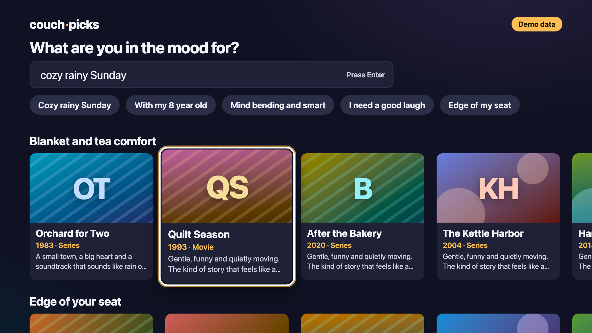

# couch-picks

A "10-foot" TV-style web app you drive with a remote. Type a mood ("cozy rainy Sunday", "something to watch with my 8 year old") or pick a preset, and couch-picks lays out rows of things to watch, each with a short note on why it fits. Everything works from the arrow keys, Enter and Back. Picks come from Claude through a small server endpoint, or from a deterministic demo generator when no API key is set. It is built with React 19, TypeScript (strict) and Vite.



All titles and artwork are generated. The cover art is CSS gradients and initials, with no external images.

## Quickstart

```sh
npm install
npm run dev
```

Open http://localhost:5173 and use the keyboard, a mouse wheel or a trackpad:

| Key | Does |
| --- | --- |
| Arrow keys | Move focus |
| Mouse wheel or two-finger swipe | Move focus one card or row per step, like the arrows |
| Enter | Search, pick a mood chip, open a pick |
| Backspace or Escape | Close the detail view |

With no key the app runs in demo mode and shows a "Demo data" badge. To use Claude, copy `.env.example` to `.env` and set `ANTHROPIC_API_KEY`. `ANTHROPIC_MODEL` is optional and defaults to `claude-sonnet-5-5`.

To host it, create a Blueprint on [Render](https://render.com) from this repo. `render.yaml` sets up one always-on Starter web service ($7 a month) in demo mode. Leave `ANTHROPIC_API_KEY` unset on a public deploy, or anyone can spend your API credits.

## How the focus engine works

`src/focus/engine.ts` is pure TypeScript with no DOM or React, and is unit tested on its own.

- **Nearest neighbor.** For a direction, candidates must lie past the current element's center. Score is the edge gap plus twice the drift from the current center line, so an aligned card beats a closer diagonal one. Left and right only look within the current band, so the end of a row is a hard edge.
- **Row memory.** Each row remembers its last focused card. Entering a row lands on that card, wherever the row is scrolled.
- **Never lost.** If the focused element disappears, focus falls back to the first card of its row, then the first element on screen. The detail overlay is its own scope and closing it restores focus exactly.

`src/focus/store.ts` holds the state outside React. Elements are measured only on a key press, from layout values that ignore transforms, so a row mid-animation never skews the next move. Focus styling is plain CSS `:focus`, so moving focus re-renders no cards. Rows scroll with `translate3d`, the whole UI sits on a 1920 by 1080 canvas scaled to the window, and `prefers-reduced-motion` turns the motion off.

## How the AI call works

`POST /api/picks` is Vite middleware (`server/vite-plugin.ts`), so it runs in both `npm run dev` and `npm run preview` with no separate server.

1. The request body is validated with zod.
2. With `ANTHROPIC_API_KEY` set, `server/anthropic.ts` calls the Messages API through `@anthropic-ai/sdk`, using structured output from a zod schema (`messages.parse` with `zodOutputFormat`). Server-side fallback is enabled, so a policy decline is retried on the model's default fallback.
3. The answer is checked against the schema, trimmed to length, capped and given stable ids. Malformed output, refusals and truncated answers become a clear 502, never a broken screen.
4. Without a key, `server/mock.ts` returns demo rows seeded by a hash of the mood, so the same mood always gives the same picks.

The key is read only from the environment on the server and never reaches the browser.

## Testing

```sh
npm run lint        # ESLint, zero warnings allowed
npm run typecheck   # tsc, strict
npm test            # Vitest unit tests
npm run build
npm run test:e2e    # Playwright, Chromium, against the built app in demo mode
```

Unit tests cover the focus engine (all directions, row memory, edges, empty rows, recovery), the focus store, the scroll math, the wheel and trackpad step logic, the mock generator, schema parsing including malformed model output, and the endpoint handler with the SDK mocked. The Playwright journey types a mood, moves through rows, opens and closes details with Backspace and Escape, checks focus returns to the same card and fails on any console error. A second journey moves focus with the mouse wheel. CI runs all of it on every push and pull request, with no secrets. `npm run screenshot` refreshes the image above.

## How this was built

I built couch-picks by directing AI coding agents (Claude Code). The spec, [SPEC.md](SPEC.md), came first: goals, non-goals and acceptance criteria. The agents wrote the code and tests against it, and lint, typecheck, unit tests and a Playwright keyboard journey gate every change.

## License

[MIT](LICENSE)
